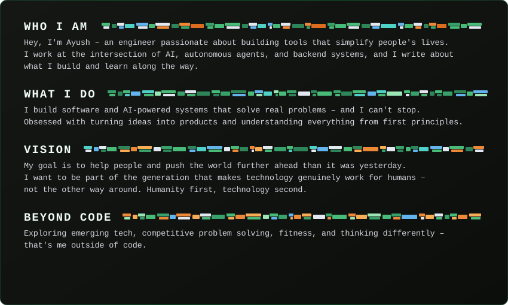

<div align="center">

<!-- Header Banner & Greeting (Hacker Terminal + Caveat Font Ayush) -->


<!-- Dynamic Animated Typing Subtitle (Matrix Green) -->
<a href="https://git.io/typing-svg">
  
</a>

<br/>

<!-- Social & Contact Badges (Hacker Obsidian & Neon Green) -->
<p align="center">
  <a href="mailto:thechampionguy100@gmail.com">
    
  </a>
  <a href="https://www.linkedin.com/in/ayush-kumar-3a082542b/">
    
  </a>
  <a href="https://twitter.com/YOUR_TWITTER_HERE">
    
  </a>
</p>

<!-- Visitor Counter (Matrix Green) -->
<p align="center">
  
</p>

</div>

---

### 👨‍💻 About Me & Vision

<div align="center">
  
</div>

---

### 💻 Tech Stack & Skills

<div align="center">

#### 🌐 Languages
<p align="center">
  
</p>

#### ⚡ Frameworks & Libraries
<p align="center">
  
</p>

#### 🗄️ Databases & Cloud Infrastructure
<p align="center">
  
</p>

#### 🔧 Developer Tools & Environment
<p align="center">
  
</p>

</div>

---

### 🧊 3D Contribution Activity

<div align="center">
  <picture>
    <source media="(prefers-color-scheme: dark)" srcset="./profile-3d-contrib/profile-night-rainbow.svg">
    <source media="(prefers-color-scheme: light)" srcset="./profile-3d-contrib/profile-night-rainbow.svg">
    
  </picture>
</div>

---

### ⏱️ Coding Habits & Weekly Activity

<!--START_SECTION:waka-->
```text
┌──[ root@telemetry:~/github_data ]
│
├── 💾 Storage Allocated:   0.0 kB
├── 🏆 Annual Contributions: 18 in 2026
├── ⚡ Status:               Active Builder / Hacker Mode
├── 📦 Public Repositories:  4
└── 🔒 Private Enclaves:     0

┌──[ Productivity Cycle // Early Bird ⚡ ]
│
├── 🌞 Morning      17 commits   ███████▒▒▒▒▒▒▒   50.00 %
├── 🌆 Daytime       5 commits   ██▒▒▒▒▒▒▒▒▒▒▒▒   14.71 %
├── 🌃 Evening       8 commits   ███▒▒▒▒▒▒▒▒▒▒▒   23.53 %
└── 🌙 Night         4 commits   ██▒▒▒▒▒▒▒▒▒▒▒▒   11.76 %

┌──[ Weekly Activity Matrix // Peak on Thursday ]
│
├── Monday            8 commits   ███▒▒▒▒▒▒▒▒▒▒▒   23.53 %
├── Tuesday           4 commits   ██▒▒▒▒▒▒▒▒▒▒▒▒   11.76 %
├── Wednesday         3 commits   █▒▒▒▒▒▒▒▒▒▒▒▒▒   08.82 %
├── Thursday         12 commits   █████▒▒▒▒▒▒▒▒▒   35.29 %
├── Friday            3 commits   █▒▒▒▒▒▒▒▒▒▒▒▒▒   08.82 %
├── Saturday          4 commits   ██▒▒▒▒▒▒▒▒▒▒▒▒   11.76 %
└── Sunday            0 commits   ▒▒▒▒▒▒▒▒▒▒▒▒▒▒   00.00 %

┌──[ Core Technologies // Dominant: HTML ]
│
├── HTML                2 repos   ███████▒▒▒▒▒▒▒   50.00 %
├── Markdown             1 repo   ████▒▒▒▒▒▒▒▒▒▒   25.00 %
└── Python               1 repo   ████▒▒▒▒▒▒▒▒▒▒   25.00 %
```
<!--END_SECTION:waka-->

---

### 🔥 Commit Streak & Activity

<div align="center">
  <a href="https://github.com/i-m-champion">
    
  </a>
</div>

---

### 📊 GitHub Overview & Metrics

<div align="center">
  
</div>

---

### 📬 Connect With Me

<div align="center">

[](mailto:thechampionguy100@gmail.com)
&nbsp;
[](https://www.linkedin.com/in/ayush-kumar-3a082542b/)
&nbsp;
[](https://twitter.com/YOUR_TWITTER_HERE)

<br/>
<br/>


</div>
