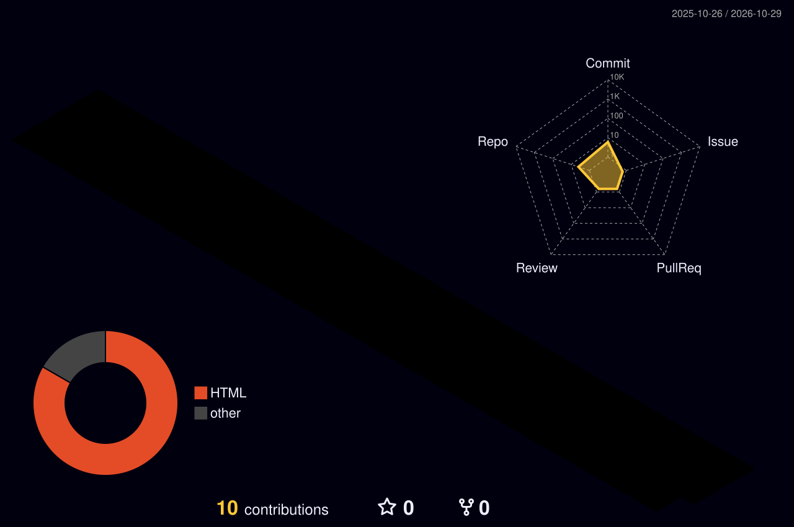

<div align="center">

<!-- Header Banner & Greeting -->


<!-- Dynamic Animated Typing Subtitle -->
<a href="https://git.io/typing-svg">
  
</a>

<br/>

<!-- Social & Contact Badges -->
<p align="center">
  <a href="mailto:thechampionguy100@gmail.com">
    
  </a>
  <a href="https://www.linkedin.com/in/ayush-kumar-3a082542b/">
    
  </a>
  <a href="https://twitter.com/YOUR_TWITTER_HERE">
    
  </a>
</p>

<!-- Visitor Counter -->
<p align="center">
  
</p>

</div>

---

### 👨‍💻 About Me

```yaml
name: Ayush
handle: i-m-champion
role: Full-Stack Developer & AI Systems Engineer
passions: [Agentic AI, Full-Stack Architecture, Clean Code, Scalable Systems]
learning: [Advanced LLM Architectures, Distributed Systems, High-Performance Computing]
current_focus: Building autonomous AI systems and high-throughput web applications
motto: "Constantly building, refining, and engineering solutions that matter."
```

- 🚀 **Full-Stack & AI Systems**: Specializing in end-to-end web engineering, AI workflow integration, and autonomous agents.
- 💻 **Modern Web Tech**: Crafting responsive, performant user experiences with **TypeScript, Next.js, React, and Tailwind CSS**.
- ⚙️ **Backend & Infrastructure**: Developing robust microservices, REST APIs, and pipelines using **Python, Node.js, Express, and PostgreSQL/MongoDB**.
- 🧠 **Algorithmic Problem Solving**: Practicing Data Structures & Algorithms regularly to build optimized, algorithmic problem-solving speed.
- 🤝 **Collaboration & Open Source**: Open to collaborating on innovative open-source projects, hackathons, and ambitious tech ventures.

---

### 🛠️ Tech Stack & Toolbox

<div align="center">

#### 🌐 Languages
<p align="center">
  
</p>

#### ⚡ Frameworks & Libraries
<p align="center">
  
</p>

#### 🗄️ Databases & Cloud
<p align="center">
  
</p>

#### 🔧 Developer Tools
<p align="center">
  
</p>

</div>

---

### 🧊 3D Contribution Activity

<div align="center">
  <picture>
    <source media="(prefers-color-scheme: dark)" srcset="./profile-3d-contrib/profile-night-rainbow.svg">
    <source media="(prefers-color-scheme: light)" srcset="./profile-3d-contrib/profile-night-rainbow.svg">
    
  </picture>
</div>

---

### ⏱️ Coding Habits & Activity Breakdown

<!--START_SECTION:waka-->
```text
🐱 My GitHub Data

📦 0.0 kB Used in GitHub's Storage
🏆 16 Contributions in the Year 2026
🚫 Not Opted to Hire
📜 4 Public Repositories
🔑 0 Private Repositories

I'm an Early 🐤

🌞 Morning        16 commits    ███████▒▒▒▒▒▒▒    50.00 %
🌆 Daytime         4 commits    ██▒▒▒▒▒▒▒▒▒▒▒▒    12.50 %
🌃 Evening         8 commits    ████▒▒▒▒▒▒▒▒▒▒    25.00 %
🌙 Night           4 commits    ██▒▒▒▒▒▒▒▒▒▒▒▒    12.50 %

📅 I'm Most Productive on Thursday

Monday             8 commits    ████▒▒▒▒▒▒▒▒▒▒    25.00 %
Tuesday            4 commits    ██▒▒▒▒▒▒▒▒▒▒▒▒    12.50 %
Wednesday          3 commits    █▒▒▒▒▒▒▒▒▒▒▒▒▒    09.38 %
Thursday          12 commits    █████▒▒▒▒▒▒▒▒▒    37.50 %
Friday              1 commit    ▒▒▒▒▒▒▒▒▒▒▒▒▒▒    03.12 %
Saturday           4 commits    ██▒▒▒▒▒▒▒▒▒▒▒▒    12.50 %
Sunday             0 commits    ▒▒▒▒▒▒▒▒▒▒▒▒▒▒    00.00 %

I Mostly Code in HTML

HTML                 2 repos    ███████▒▒▒▒▒▒▒    50.00 %
Markdown              1 repo    ████▒▒▒▒▒▒▒▒▒▒    25.00 %
Python                1 repo    ████▒▒▒▒▒▒▒▒▒▒    25.00 %
```
<!--END_SECTION:waka-->

---

### 🔥 Commit Streak & Activity

<div align="center">
  <a href="https://github.com/i-m-champion">
    
  </a>
</div>

---

### 📊 GitHub Stats & Summary

<div align="center">
  
</div>

---

### 📬 Get In Touch

<div align="center">

[](mailto:thechampionguy100@gmail.com)
&nbsp;
[](https://www.linkedin.com/in/ayush-kumar-3a082542b/)
&nbsp;
[](https://twitter.com/YOUR_TWITTER_HERE)

<br/>
<br/>


</div>
